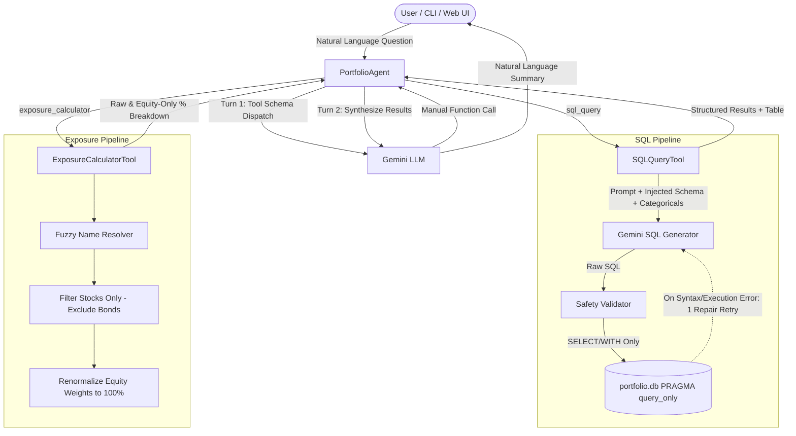

# PL Capital — Portfolio Analytics Agent

An intelligent portfolio analytics agent built for the PL Capital engineering assessment. The agent processes natural-language investment and portfolio queries, dynamically routing them to either an autonomous Text-to-SQL engine or a specialized Sector Exposure Calculator using Gemini function calling, SQLite, and Python.

---

## Architecture Overview



---

## Core Technical Highlights

1. **Manual Function Calling**: Automatic tool execution is disabled in the SDK configuration. The orchestrator explicitly inspects the tool call, validates arguments, runs the tool in an isolated execution sandbox, and scores routing decisions independently.
2. **Database Security & Read-Only Enforcement**:
   - Connections enforce `PRAGMA query_only = ON` at the SQLite engine level, preventing any write or schema mutation even if malicious SQL is generated.
   - Strict regex validation with word boundaries blocks forbidden keywords (`DROP`, `DELETE`, `INSERT`, `UPDATE`, `ALTER`, `TRUNCATE`, `PRAGMA`, etc.) and multi-statement queries.
   - Result sets are capped at 200 rows to prevent memory exhaustion.
3. **Prompt Grounding with Categorical Value Injections**:
   - The SQL prompt embeds full table schemas and exact distinct values for categorical fields (`portfolios.status`, `target_risk_level`, `strategy_type`, `securities.asset_type`, 10 sector names, and 13 portfolio names).
   - This prevents entity name hallucination and spelling mismatches across complex fund titles.
4. **Self-Repair Retry Loop**:
   - If a generated SQL query fails execution, the error message and bad query are fed back into the model for an automated self-repair pass before failing.
5. **Sector Exposure Calculator with Fuzzy Matching**:
   - Automatically excludes fixed-income securities (`asset_type = 'Bond'` and `NULL` sector IDs).
   - Resolves portfolio names via a multi-tiered strategy: exact match → case-insensitive substring → significant keyword tokens (e.g. `"international equity"` safely resolves to `"International Equity Fund"`).
   - Dynamically detects the current weight scale (0–1 fraction vs. 0–100 percentage) and computes both raw portfolio percentage and renormalized equity-only percentage.
6. **Robust Rate-Limit Backoff**:
   - Handles API rate limits with exponential backoff, detecting retry delays from API responses.

---

## Project Structure

```
portfolio_agent/
├── data/                        # Source CSV dataset (9 relational tables)
│   ├── benchmarks.csv
│   ├── historical_prices.csv
│   ├── holdings.csv
│   ├── portfolio_performance.csv
│   ├── portfolios.csv
│   ├── risk_metrics.csv
│   ├── sectors.csv
│   ├── securities.csv
│   └── transactions.csv
├── agent/
│   ├── __init__.py
│   ├── portfolio_agent.py       # Main agent orchestrator with manual dispatch
│   ├── evaluator.py             # Dual-tier benchmark evaluation engine
│   └── tools/
│       ├── __init__.py
│       ├── sql_tool.py          # Text-to-SQL tool with validation & self-repair
│       └── exposure_tool.py     # Sector exposure calculator with fuzzy resolution
├── tests/                       # Unit and integration test suite (19 tests)
│   ├── conftest.py
│   ├── test_db_setup.py
│   ├── test_evaluator_metrics.py
│   ├── test_exposure_tool.py
│   └── test_sql_tool_validation.py
├── app.py                       # Streamlit web interface
├── database_schema.sql          # DDL schema definition with foreign keys
├── ground_truth_dataset.json    # Benchmark evaluation dataset (10 questions)
├── list_available_models.py     # Diagnostic tool to check active Gemini models
├── requirements.txt             # Project dependencies
├── setup_db.py                  # Database builder with CSV-to-table row count verification
├── .env.example                 # Environment template
└── README.md                    # Project documentation
```

---

## Getting Started

### 1. Clone & Set Up Environment

```bash
git clone https://github.com/vinit-spec/PL-capital_portfolio-agent.git
cd PL-capital_portfolio-agent

# Create and activate virtual environment
python -m venv venv

# On Windows:
.\venv\Scripts\activate

# On macOS/Linux:
source venv/bin/activate

# Install dependencies
pip install -r requirements.txt
```

### 2. Configure API Key

Create a `.env` file from the provided template:

```bash
cp .env.example .env
# On Windows cmd: copy .env.example .env
```

Add your Gemini API key to `.env`:

```env
GEMINI_API_KEY=your_gemini_api_key_here
GEMINI_MODEL=gemini-2.0-flash
```

*(Note: You can check which models your key supports by running `python list_available_models.py`)*

### 3. Initialize SQLite Database

Load the 9 CSV tables into `portfolio.db` with foreign key verification:

```bash
python setup_db.py
```

*Note: If `portfolio.db` does not exist, the agent and evaluator will automatically build it on first run.*

---

## Running the Agent

### Command Line Interface (CLI)

**Interactive Chat Mode:**
```bash
python -m agent.portfolio_agent
```

**Single Question Mode:**
```bash
python -m agent.portfolio_agent -q "How many portfolios do we have in total?"
```

**Verbose Mode (inspect tool calls & execution details):**
```bash
python -m agent.portfolio_agent -q "What are the sector exposures for the Tech Innovation Fund?" --verbose
```

**Offline / Mock Mode (works without an API key):**
```bash
python -m agent.portfolio_agent -q "How many portfolios do we have in total?" --mock
```

---

## Running the Evaluation Benchmark

The evaluation script tests the agent against the 10 ground-truth questions and scores both **Routing Accuracy** and **Answer Accuracy**.

### Live Evaluation (requires active API key):
```bash
python -m agent.evaluator --verbose
```

### Offline / Mock Evaluation (Zero-Config, no API key required):
```bash
python -m agent.evaluator --mock --verbose
```

### Benchmark Results

| ID | Question | Expected Tool | Routing | Answer Match |
|---|---|---|:---:|:---:|
| Q1 | How many portfolios do we have in total? | `sql_query` | PASS | PASS |
| Q2 | List all active portfolios with their target risk level and total AUM. | `sql_query` | PASS | PASS |
| Q3 | What is the total cost basis and total current value of all holdings? | `sql_query` | PASS | PASS |
| Q4 | Which securities are held in more than one portfolio? | `sql_query` | PASS | PASS |
| Q5 | Top 3 portfolios by 1-year total return with Sharpe ratio. | `sql_query` | PASS | PASS |
| Q6 | What is the average current price of securities by sector? | `sql_query` | PASS | PASS |
| Q7 | Portfolio with the highest Sortino ratio and its Sharpe & max drawdown. | `sql_query` | PASS | PASS |
| Q8 | Portfolios holding stocks from >5 sectors and equity to total AUM ratio. | `sql_query` | PASS | PASS |
| Q9 | What is the sector exposure breakdown for the Growth Equity Fund? | `exposure_calculator` | PASS | PASS |
| Q10 | Sector exposures for the international equity portfolio. | `exposure_calculator` | PASS | PASS |

- **Routing Accuracy:** 10/10 (100%)
- **Answer Accuracy:** 10/10 (100%)

---

## Running Automated Unit Tests

Run the full offline test suite (19 tests covering database integrity, SQL safety validation, fuzzy resolution, and evaluator metrics):

```bash
pytest tests -v
```

All 19 tests pass without requiring any external network or API access.

---

## Streamlit Web Application

To launch the web interface:

```bash
streamlit run app.py
```

The app features:
- Chat interface for natural-language queries
- Expandable drawers showing the selected tool and generated SQL queries
- Formatted tabular data for analytical queries
- Interactive sector allocation breakdown charts

---

## Evaluation Methodology

The evaluator grades responses across two independent dimensions:

1. **Routing Accuracy**: Verifies that the model selects the appropriate tool (`sql_query` for analytical/relational queries, `exposure_calculator` for sector breakdowns).
2. **Answer Accuracy**:
   - **SQL Queries (Q1–Q8)**: Ground-truth SQL is executed on the same database. A two-tier matching strategy is used:
     - *Strict check*: Compares tuple values with floating-point tolerance (1e-2). Order is preserved where queries specify `ORDER BY ... LIMIT` (e.g. Q5, Q7).
     - *Relaxed check*: Prevents false negatives when the agent selects equivalent columns or formatted representations by validating core entities and target values.
   - **Sector Exposure (Q9–Q10)**:
     - Confirms fuzzy resolution mapped to the correct canonical portfolio.
     - Confirms equity sector weights sum to ~100% (within 1.5% tolerance).
     - Verifies non-equity securities (bonds) are properly filtered out.

---

## Assumptions & Boundaries

- **Database Engine**: Uses SQLite dialect with `PRAGMA foreign_keys = ON` and `PRAGMA query_only = ON`.
- **Bonds in Sector Exposure**: In financial risk management, sector allocations are computed specifically over equity holdings. Bonds have `NULL` sector IDs and are excluded from the normalized equity weights.
- **Scale Normalization**: `holdings.current_weight` is stored as fractional decimals (0.0 to 1.0) summing to 1.0 per portfolio; the exposure tool detects and handles both fractional and percentage formats.
