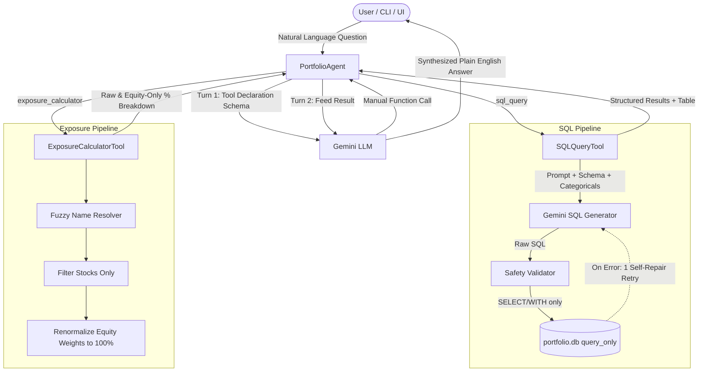

# PL Capital — AI Portfolio Analytics Agent

An AI-powered portfolio analytics agent built for the PL Capital engineering assessment. The agent routes natural-language financial queries to either an autonomous Text-to-SQL tool or a specialized Sector Exposure Calculator using **Gemini function-calling**, **SQLite**, and **Python**.

---

## Architecture



---

## Key Design Decisions

1. **Manual Function Calling**: Automatic function execution by the Gemini SDK is explicitly disabled. The orchestrator intercepts the `function_call` payload, logs the chosen tool and parameters, executes safety checks, and handles errors before formatting the response. This also allows the evaluator to score routing decisions independently.
2. **Read-Only Database Safety**:
   - The query connection applies `PRAGMA query_only = ON`, making data modifications physically impossible at the SQLite engine level.
   - The query validator permits only single statements starting with `SELECT` or `WITH`, blocking any DDL/DML keywords (`DROP`, `DELETE`, `INSERT`, `UPDATE`, `ALTER`, etc.) with regex word boundaries.
   - All results are capped at 200 rows to prevent memory exhaustion.
3. **Prompt Grounding with Categorical Injections**:
   - The Text-to-SQL prompt includes the complete database schema along with all distinct categorical values (`status`, `target_risk_level`, `asset_type`, `strategy_type`, 10 sector names, and 13 portfolio names).
   - Prevents hallucinations and spelling discrepancies across portfolio or sector names.
4. **Self-Repair Retry**:
   - If an initial SQL query fails to execute, the error message and the failed query are fed back into the model for a single automated correction attempt.
5. **Exposure Normalization & Fuzzy Resolution**:
   - Only equity holdings (`asset_type = 'Stock'`) are considered; bond holdings are excluded.
   - The calculator reports both `raw_pct` (% of the entire portfolio) and `equity_pct` (renormalized to 100% across equities).
   - Portfolio names are matched via exact match, case-insensitive substring, and significant token matching (e.g., `"international equity"` correctly resolves to `"International Equity Fund"`).
   - Weight scale (0–1 fraction vs. 0–100) is dynamically detected.
6. **Rate-Limit Resilience**:
   - API calls implement exponential backoff upon encountering HTTP 429 / resource exhaustion.

---

## Project Structure

```
portfolio_agent/
├── .env.example                 # Environment configuration template
├── .gitignore                   # Excludes portfolio.db, .env, and caches
├── requirements.txt             # Lean dependencies
├── setup_db.py                  # Builds portfolio.db from bundled CSVs
├── database_schema.sql          # SQLite schema
├── ground_truth_dataset.json    # 10 benchmark Q&As
├── list_available_models.py     # Utility to check models supported by your API key
├── data/                        # Bundled CSV datasets (9 tables)
├── agent/
│   ├── portfolio_agent.py       # Main agent orchestrator (manual function routing)
│   ├── evaluator.py             # Benchmark evaluation engine (strict + relaxed grading)
│   └── tools/
│       ├── sql_tool.py          # Text-to-SQL tool with validation & self-repair
│       └── exposure_tool.py     # Sector exposure calculator with fuzzy resolution
├── tests/                       # Automated offline test suite (19 tests)
│   ├── conftest.py
│   ├── test_db_setup.py
│   ├── test_exposure_tool.py
│   ├── test_sql_tool_validation.py
│   └── test_evaluator_metrics.py
└── app.py                       # Optional Streamlit chat interface
```

---

## Quick Start

### 1. Prerequisites
Python 3.11+ is recommended. Install required packages:
```bash
pip install -r requirements.txt
```

### 2. Configure API Key & Model
Copy the environment template:
```bash
cp .env.example .env
# On Windows cmd: copy .env.example .env
```
Edit `.env` and set your key:
```env
GEMINI_API_KEY=your_gemini_api_key_here
GEMINI_MODEL=gemini-2.0-flash
```
*(You can run `python list_available_models.py` after inserting your key to verify which Flash models are active for your API tier).*

### 3. Initialize Database
Build `portfolio.db` from the bundled CSVs:
```bash
python setup_db.py
```
*Note: If `portfolio.db` is not present, `setup_db.py` will run automatically when running tests or the agent.*

### 4. Run Offline Test Suite
Run the 19 automated tests (no API key required):
```bash
python -m pytest tests
```

### 5. Run the Agent (CLI)

**Single-question mode:**
```bash
python -m agent.portfolio_agent -q "How many portfolios do we have in total?"
python -m agent.portfolio_agent -q "What are the sector exposures for the Tech Innovation Fund?" --verbose
```

**Interactive REPL:**
```bash
python -m agent.portfolio_agent
```

### 6. Run the Evaluator
Run all 10 benchmark questions from `ground_truth_dataset.json`:
```bash
python -m agent.evaluator --verbose
```
Results are saved automatically to `eval_results.json`.

### 7. (Optional) Run Streamlit UI
```bash
streamlit run app.py
```

---

## Evaluation Methodology

The evaluator separates **Routing Accuracy** from **Answer Accuracy**:

1. **Routing Accuracy**: Checks whether the agent invoked the expected tool (`sql_query` vs `exposure_calculator`).
2. **Answer Accuracy**:
   - **For SQL questions (Q1–Q8)**:
     - The ground-truth SQL query is executed directly on the same database.
     - **Strict check**: Compares row tuples. Order-sensitive for queries with `ORDER BY ... LIMIT` (e.g. Q5, Q7); order-insensitive set matching for others. 1% relative tolerance on floating point numbers.
     - **Relaxed semantic check**: Prevents penalizing the agent when it selects a slightly different set of valid columns (e.g. omitting synthetic IDs or selecting alternative column subsets for rankings) by validating that the correct target entities and values are returned.
   - **For Exposure questions (Q9–Q10)**:
     - Validates that the expected portfolio was resolved.
     - Verifies that equity exposure weights sum to ~100% (within 1.5% tolerance).
     - Confirms that no bond holdings/sectors are included in the equity breakdown.

---

## Known Limitations

- **Complex Multi-Step Questions**: Questions requiring joint SQL query execution followed by ad-hoc mathematical transformations (hybrid tool queries) are routed to SQL.
- **Dialect Specifics**: The agent targets SQLite dialect. Non-SQLite functions (e.g., PostgreSQL `ILIKE` or `GENERATE_SERIES`) are replaced with standard SQLite constructs.
- **Read-Only Scope**: The agent does not support write transactions, updates, or schema mutations by design.
